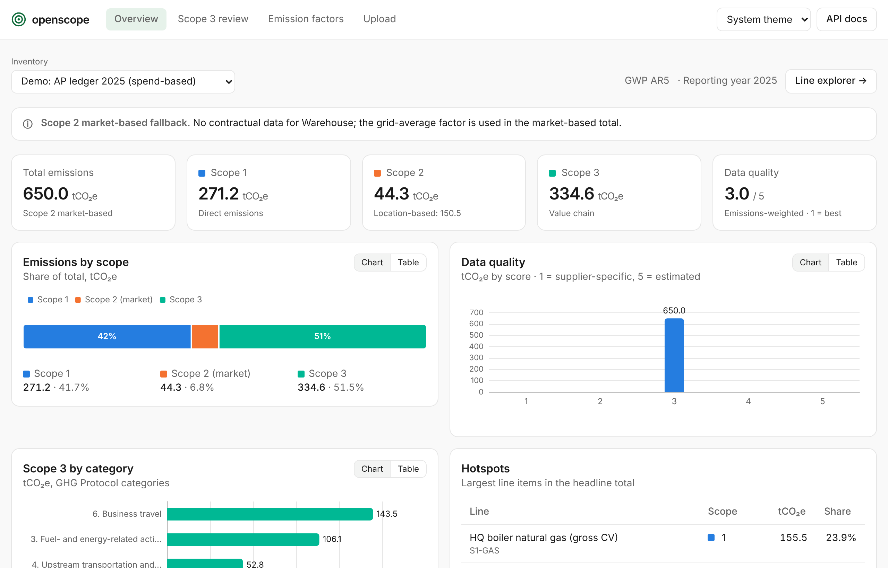
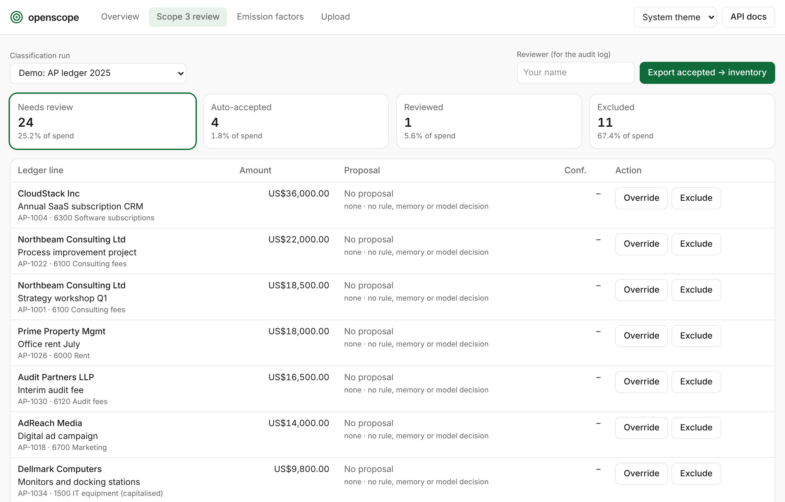
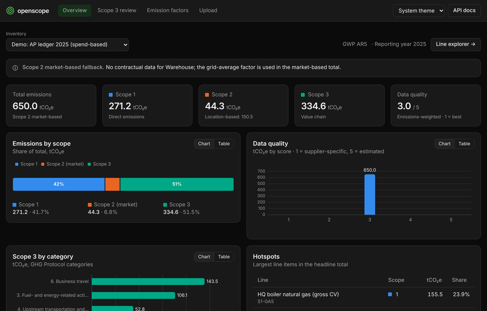

# openscope

[](https://github.com/SabawoonDaqiq8/openscope/actions/workflows/ci.yml)

[](LICENSE)

[](https://github.com/astral-sh/ruff)


**Open-source, auditable carbon accounting.** A Python engine for calculating GHG Protocol
Scope 1, 2 and 3 emissions, where every number can be traced back to its activity data,
emission factor, unit conversion and GWP.

> Status: **alpha (v0.4)**: core engine, the full **UK Government (DESNZ) 2025**
> conversion-factor set (2,672 factors), an **AI-assisted Scope 3 spend classifier** with
> human review and an audit trail, and a **web dashboard** (FastAPI + Angular).



## Dashboard

```bash
docker build -t openscope .
docker run -p 8000:8000 -v openscope-data:/data openscope
# open http://localhost:8000 → "Load demo data"; API docs at /docs
```

| | |
|---|---|
| **Overview**: scope totals, Scope 2 dual reporting, Scope 3 by category, hotspots, data quality, disclosure warnings | **Line explorer**: every calculated line with its step-by-step audit trail |
| **Scope 3 review**: accept / override / exclude classified ledger lines; every decision is audit-logged and teaches supplier memory | **Emission factors**: search all 2,700+ factors with source and GWP basis |



**Stack:** FastAPI · SQLAlchemy (SQLite, Postgres-ready) · Angular 22 (standalone components,
signals, zoneless) · Tailwind CSS · Apache ECharts · TypeScript types generated from the
OpenAPI spec · one Docker image. Charts use a palette validated for colour-vision deficiency,
with direct labels, a table view for every chart, and light and dark themes.

<details><summary>Dark mode</summary>


</details>

<details><summary>Local development (without Docker)</summary>

```bash
pip install -e ".[dev]"
uvicorn openscope.api.app:app --reload          # API on :8000 (docs at /docs)
cd web && npm ci && npm start                    # Angular on :4200, proxies /api
npm run gen:api                                  # regenerate TS types after API changes
```
Set `OPENSCOPE_LLM=1` and `ANTHROPIC_API_KEY` to enable Claude classification in the UI.
Configuration is documented in [`api/settings.py`](src/openscope/api/settings.py).
</details>

## Why

Carbon accounting is a data problem dressed up as a reporting problem. Disclosure regimes
such as the EU CSRD/ESRS E1, ISSB IFRS S2 and California SB 253 all require GHG inventories
that are **complete, consistent and assurable**. Most of the tools used today are spreadsheets
or closed SaaS products whose calculations can't be inspected.

openscope's design principles:

| Principle | How it shows up |
|---|---|
| **Traceability** | Every result carries a human-readable audit `trace` of each calculation step |
| **Factor provenance** | Factors are versioned CSV with source, year, region and a `status` (`reference` / `illustrative` / `custom`) |
| **Correct units** | Dimension-checked unit conversions; currencies are never converted implicitly |
| **GWP flexibility** | Per-gas factors are converted with IPCC AR5 or AR6 GWPs at calculation time |
| **Scope 2 dual reporting** | Location- and market-based totals are kept separate and never double-counted |
| **Real datasets** | Official DESNZ 2025 factors bundled; importer for future editions |
| **Spend normalisation** | FX + price-year deflation for spend-based (EEIO) factors, fully traced |
| **Data quality** | 1–5 score per line item (GHG Protocol / PCAF-style), emissions-weighted for the inventory |

## Quick start

```bash
pip install -e ".[dev]"

# A UK company inventory computed entirely with official DESNZ 2025 factors
openscope calculate examples/uk_demo_activities.csv --dataset desnz-2025 --gwp AR5 --year 2025
```

```text
GHG inventory summary (tCO2e)
────────────────────────────────────────────────────────────
  Scope 1                                        271.186
  Scope 2 (location-based)                       150.458
  Scope 2 (market-based)                          44.252
    (grid-average fallback for: Warehouse)
  Scope 3                                        334.580
    1. Purchased goods and services                0.612
    3. Fuel- and energy-related activities       106.106
    4. Upstream transportation and distribut      52.848
    5. Waste generated in operations              11.452
    6. Business travel                           143.535
    7. Employee commuting                         20.027
────────────────────────────────────────────────────────────
  Total                                          650.019
```

Add `--trace` to see the audit trail for every line:

```text
[S1-001]
  Factor EPA-STAT-NATGAS — Natural gas - stationary combustion [US EPA GHG Emission Factors Hub (Table 1), 2024; reference]
  Converted 12,000 therm → 1,200 MMBtu
  CO2: 1,200 × 53.06 kg/MMBtu = 63,672 kg × GWP 1 (AR6) = 63,672 kg CO2e
  CH4: 1,200 × 0.001 kg/MMBtu = 1.2 kg × GWP 29.8 (AR6) = 35.76 kg CO2e
  N2O: 1,200 × 0.0001 kg/MMBtu = 0.12 kg × GWP 273 (AR6) = 32.76 kg CO2e
  Total: 63,740.5 kg CO2e; data quality 3/5 (average_data)
```

### As a library

```python
from openscope import ActivityRecord, Calculator, Inventory, Scope

calc = Calculator(gwp_set="AR6", reporting_year=2025)
result = calc.calculate(
    ActivityRecord(
        activity_id="boiler",
        quantity=12_000,
        unit="therm",
        scope=Scope.SCOPE_1,
        factor_id="EPA-STAT-NATGAS",
    )
)
print(result.co2e_t, result.trace)

batch = calc.calculate_many(activities)  # errors are collected, not raised
print(Inventory(batch.results).summary())
```

### AI-assisted Scope 3 from your purchase ledger

```bash
pip install -e ".[ai]"            # Claude classifier (needs ANTHROPIC_API_KEY)
openscope classify ledger.csv --out review.csv --llm --factors my_spend_factors.csv
# ... review.csv in a spreadsheet: accept / override / exclude ...
openscope review-apply review.csv --reviewer "Your Name" \
    --activities-out spend.csv --audit-log audit.jsonl --memory suppliers.json
openscope calculate spend.csv --factors my_spend_factors.csv
```

The pipeline runs rules, then supplier memory, then Claude (batched, schema-constrained to your
factor list, prompt-cached), then a confidence gate, then human review. The audit log records
every reviewer decision. Run with `--labels` to measure accuracy, coverage and auto-accept
precision. See [docs/classification.md](docs/classification.md).

### Factor datasets

```bash
openscope datasets                                   # bundled: desnz-2025, sample
openscope factors --dataset desnz-2025 --search "Hotel stay"
openscope import-desnz ghg-conversion-factors-2026-flat-format.xlsx --out desnz_2026.csv
```

**DESNZ and GWPs.** DESNZ publishes per-gas values already converted to CO2e with AR5 GWPs.
openscope converts them back to kilograms of each gas, so DESNZ factors can be recalculated
under **AR6**. Factors published only as a CO2e total keep their `gwp_basis` (AR5, or AR4 for
well-to-tank bioenergy), and the trace warns when that differs from your inventory's GWP set.

### Spend-based factors: currency and price year

```bash
openscope calculate spend.csv --fx fx.csv --price-index deflator.csv
```

`fx.csv` holds `year,from,to,rate` and `deflator.csv` holds `currency,year,index`. Get these from
an authoritative source such as a central bank or statistics office; openscope ships no FX or
inflation data. A currency mismatch without FX rates is an error. A price-year mismatch without
an index produces a warning.

### Bring your own factors

```bash
openscope factors --search grid
openscope calculate my_activities.csv --factors desnz_2025.csv --factors supplier_pcfs.csv
```

Factor CSV columns are documented in [`factors/registry.py`](src/openscope/factors/registry.py).
Later files override earlier ones by `factor_id`.

## ⚠️ About the bundled factors

* **`desnz-2025`**: the complete UK Government GHG Conversion Factors for Company Reporting
  2025 (flat file v1), imported unmodified apart from unit and GWP handling.
  Contains public sector information licensed under the
  [Open Government Licence v3.0](https://www.nationalarchives.gov.uk/doc/open-government-licence/version/3/).
* **`sample`** (always loaded unless `--no-bundled`): a few US EPA factors
  (`status=reference`) and **illustrative** placeholders (ids starting `DEMO-`) for demos and
  tests only. The CLI warns when an inventory relies on them.

## Methodology

See [docs/methodology.md](docs/methodology.md).

## Development

```bash
pytest                                    # Python tests (engine, classifier, API)
ruff check . && mypy src                  # lint + strict type-check
cd web && npx ng test --watch=false       # Angular unit tests (Vitest)
```

## License

MIT © Sabawoon Daqiq
