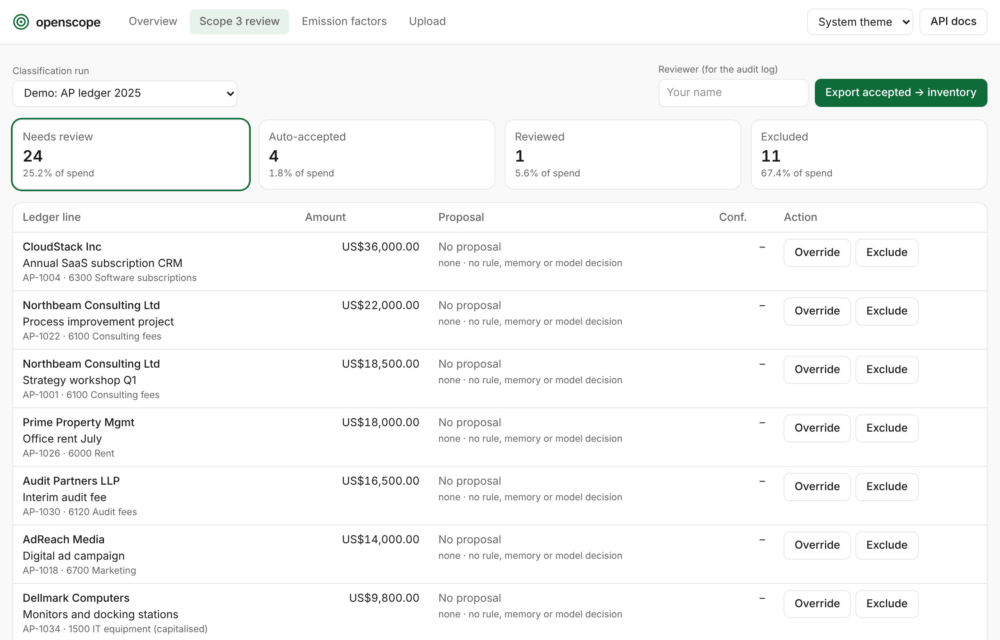
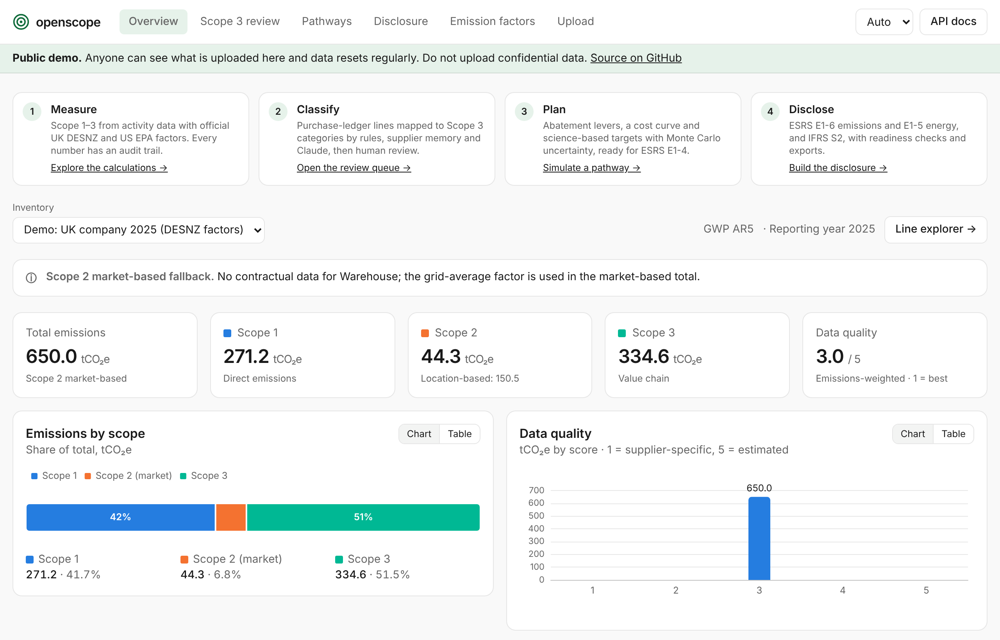
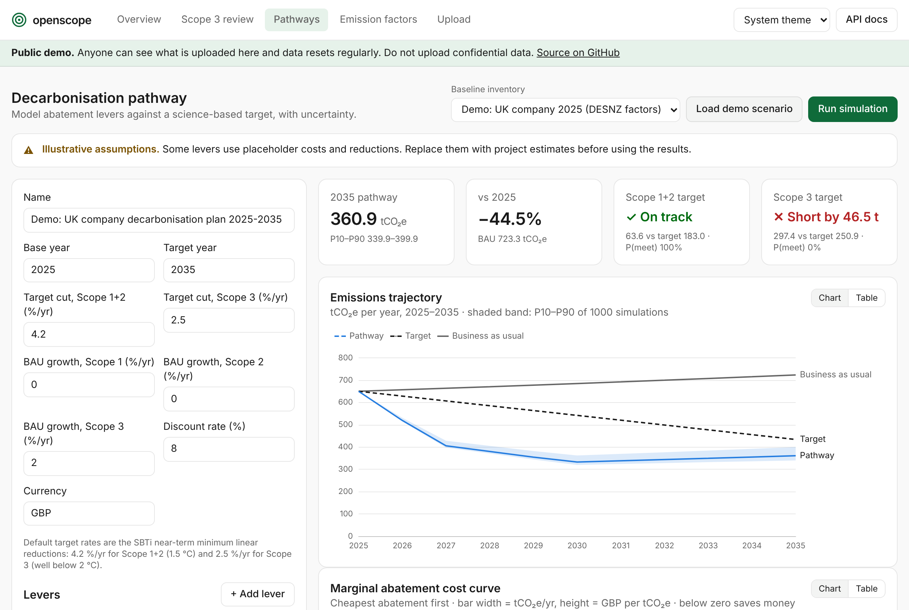
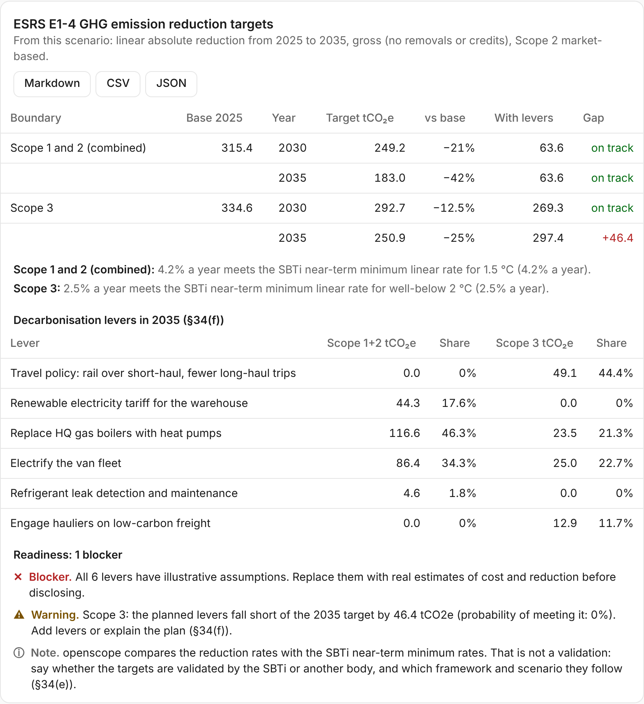
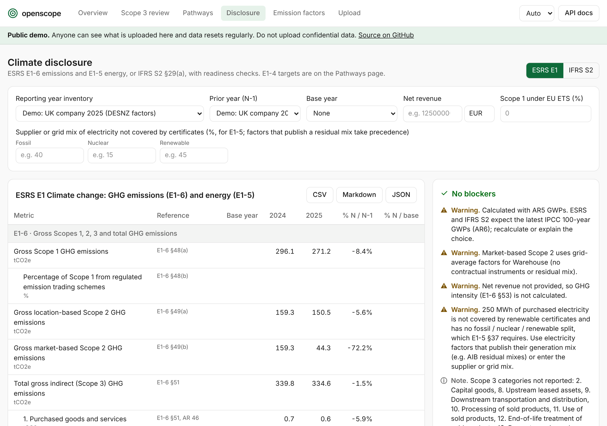

# Case study: from a purchase ledger to an ESRS climate disclosure

openscope is an open-source carbon accounting platform I built to work through every stage
of corporate GHG reporting: activity data, emission factors, the GHG inventory, a
decarbonisation plan and the ESRS climate disclosures. This page follows a fictional UK
company through that workflow, and explains the methodology decisions behind each step.

Every number below comes from the demo data in this repository and can be reproduced with
the commands shown. Try it in the [live demo](https://openscope-xi6p.onrender.com/overview).

## The company

A UK services company with a head office, a warehouse and a small van fleet. For 2025 it has:

* gas and electricity bills for both sites, fuel cards for the vans and a refrigerant top-up
  (Scope 1 and 2);
* a renewable (REGO-backed) electricity tariff at the head office, but not at the warehouse;
* freight, waste, flights, rail, hotels and homeworking data (Scope 3);
* a 40-line accounts-payable export with everything else it bought;
* the 2024 inventory, for comparison.

It falls under the CSRD and needs ESRS E1: gross emissions (E1-6), energy (E1-5) and
reduction targets (E1-4).

## 1. Turning a purchase ledger into Scope 3 data

Most companies start Scope 3 with their purchase ledger, which has vendors, memos and GL
codes but no categories or emission factors. openscope classifies each line in stages, from
cheapest and most certain to most expensive:

1. **Rules** on GL codes and keywords (e.g. GL 6400 "Travel - airfare" → Category 6);
2. **Supplier memory**: a vendor a reviewer has already classified is classified the same
   way next time;
3. **Claude** (optional), with structured output constrained to the 15 Scope 3 categories
   and the factor list;
4. a **confidence gate**: anything below the threshold goes to a human.

The review queue is sorted by spend, so the reviewer starts with the lines that matter most,
and every decision is written to an audit log. On the 40-line sample, rules alone decide
37.5 % of lines with 100 % precision on what they auto-accept. I chose auto-accept precision
as the headline metric: the cost of a wrong category that skips review is much higher than
the cost of one more line in the queue.



## 2. Calculating the inventory

```bash
openscope calculate examples/uk_demo_activities.csv --dataset desnz-2025 --gwp AR5 \
    --year 2025 --derive-cat3
```

| | 2024 | 2025 | Change |
| --- | --: | --: | --: |
| Scope 1 | 296.1 | 271.2 | −8.4 % |
| Scope 2, location-based | 159.3 | 150.5 | −5.6 % |
| Scope 2, market-based | 159.3 | 44.3 | −72.2 % |
| Scope 3 | 339.8 | 334.6 | −1.5 % |
| **Total, market-based** | **795.2** | **650.0** | **−18.3 %** |

tCO2e, UK Government (DESNZ) 2025 conversion factors, IPCC AR5 GWPs.

Decisions behind these numbers:

* **Every number is traceable.** Each line keeps the factor, unit conversion, GWP and
  arithmetic that produced it, the way an auditor would rebuild it:
  `CO2: 850,000 × 0.18259 kg/kWh = 155,201 kg × GWP 1`.
* **Gases are stored as masses, not CO2e.** DESNZ publishes per-gas values already converted
  with AR5 GWPs. The importer converts them back to kilograms of each gas, so the same
  inventory can be recalculated under AR6. ESRS asks for AR6; the demo uses AR5 to match the
  published factors, and the disclosure flags it.
* **Scope 2 is reported both ways.** The renewable tariff cuts market-based Scope 2 by 72 %
  while location-based falls 6 %. Showing both stops a contractual instrument from looking
  like a physical reduction. The warehouse has no supplier-specific factor, so its
  market-based figure falls back to the grid average, and the disclosure says so.
* **Category 3 is derived, not typed in.** Fuel- and energy-related emissions (well-to-tank,
  grid losses) follow directly from Scope 1 and 2 quantities, so openscope derives them:
  8 lines and 109.5 t here, a third of Scope 3. DESNZ doesn't link a fuel to its upstream
  factor, but its factor IDs share a structure (`1_100_1004_6` → `11_100_1004_6`), so the
  importer builds the links for 552 factors. Electricity is counted once per site, and any
  upstream factor already reported by hand is skipped, so nothing is counted twice.
* **Biogenic CO2 (103.7 t) is reported outside the scopes**, mostly from biomass in the UK
  grid, as ESRS requires.



## 3. Planning the reduction

The company wants a target aligned with the SBTi near-term minimum: 4.2 % a year for Scope 1+2
and 2.5 % a year for Scope 3, from 2025 to 2035. The pathway simulator tests six levers
against the inventory:

| Lever | tCO2e a year | GBP per tCO2e |
| --- | --: | --: |
| Travel policy: rail over short-haul, fewer long-haul trips | 40.3 | −994 |
| Renewable electricity tariff for the warehouse | 44.3 | 136 |
| Replace HQ gas boilers with heat pumps | 135.9 | 227 |
| Electrify the van fleet | 106.9 | 254 |
| Refrigerant leak detection and maintenance | 4.6 | 583 |
| Engage hauliers on low-carbon freight | 10.6 | 947 |

The lever costs and reductions are illustrative, and the tool blocks them from being
disclosed until they are replaced.

* **Marginal abatement cost curve**: capex is annualised with the capital recovery factor and
  added to the change in operating cost. The travel policy saves money; the others cost
  between £136 and £947 per tonne.
* **No double counting**: levers act in merit order on what earlier levers left, so when two
  levers reach the same line, the second only cuts what the first left.
* **Separate targets for Scope 1+2 and Scope 3**: the plan beats the Scope 1+2 target by a
  wide margin (63.6 t against 183.0 t in 2035) but misses Scope 3 by 46.4 t, because Scope 3
  grows 2 % a year in business as usual. A single combined target would have hidden this.
* **Uncertainty**: a Monte Carlo simulation over each lever's effectiveness and growth gives a
  2035 range of 340–400 t and the probability of meeting each target: 100 % for Scope 1+2 and
  0 % for Scope 3. That is the conversation to have with management: the Scope 3 plan needs
  another lever, not more confidence in the current ones.



## 4. Disclosing under ESRS E1

```bash
openscope disclose examples/uk_demo_activities.csv --prior examples/uk_demo_activities_2024.csv \
    --dataset desnz-2025 --derive-cat3 --year 2025 --net-revenue 12500000 --currency GBP \
    --ets-share 0
```

**E1-6 gross emissions**: Scopes 1, 2 and 3 with comparatives, significant Scope 3
categories, totals and an intensity of 52.0 tCO2e per million GBP of revenue.

**E1-5 energy**: 2,033 MWh in total, 29.5 % renewable. Energy content comes from net
calorific values derived from the DESNZ dataset itself (the same fuel is published per unit
and per kWh). Purchased electricity is counted once per site, and certificate-backed
renewables are capped at what each site consumed. For EU sites, the
[AIB residual mixes](https://www.aib-net.org/facts/european-residual-mix) split grid
electricity into fossil, nuclear and renewable automatically. The UK warehouse's 250 MWh
has no published mix, so it stays *undetermined* with a warning rather than being guessed.

**E1-4 targets**: the pathway scenario becomes the targets disclosure. It includes the base
value, target values for 2030 and 2035, the scope shares in the combined target, the gases
covered, a comparison with the SBTi minimum rates, and each lever's contribution.



**Readiness checks**: each table lists what an assurance provider would raise, at three
levels:
* **blocker**: illustrative factors or levers;
* **warning**: AR5 GWPs, a grid-average fallback, an undetermined energy mix, a Scope 3
  target the plan does not meet;
* **note**: a target compared with SBTi rates but not validated, biogenic CO2.

A **basis of preparation** is generated from the calculation metadata. Everything exports
as Markdown, CSV or JSON.



## Judgement calls

Some decisions were about what *not* to do:

* **No bundled AIB data.** The AIB residual mixes are copyright of the AIB, and its terms bar
  distributing the underlying factors in a derivative tool. openscope ships an importer
  instead: users download the workbook and cite the AIB.
* **No guessed numbers.** An energy mix that isn't published stays undetermined; a
  generation mix whose shares are more than 1 % off a total of 100 % is dropped, not rescaled; an SBTi comparison is
  labelled as an indication, not a validation.
* **Spend data is never silently converted.** A spend line in a different currency or price
  year from its factor needs exchange rates and a price index, or it fails or warns.

## Engineering

* **Backend**: Python, pydantic, FastAPI, SQLAlchemy; a CLI for every workflow.
* **Frontend**: Angular (standalone components, signals, zoneless), Tailwind, ECharts. API
  types are generated from the OpenAPI spec, and CI fails if they drift.
* **Data**: 2,672 DESNZ 2025 factors and 1,016 US EPA USEEIO spend factors, imported by
  tested importers that reconcile per-gas values against published totals.
* **Tests**: 157 Python tests, frontend unit tests, and 27 Playwright end-to-end tests against
  the production build. The end-to-end tests check the main flows, fail on any console or
  CSP error, run axe accessibility checks on every page in light and dark mode, and check the
  layout at phone width.
  CI runs Python 3.11–3.13 and smoke-tests the Docker image.
* **Public demo hardening**: strict Content Security Policy, write rate limits, upload size
  caps and protected demo data.

## What I'd build next

* XBRL tagging of the ESRS tables against the EFRAG taxonomy.
* EEA grid factors for location-based EU electricity (CC BY, so they can be bundled).
* PCAF financed emissions for banks and investors.
* Intensity targets and year-on-year progress tracking in E1-4.

Source code: this repository, MIT License. References are to ESRS Set 1 (Delegated
Regulation (EU) 2023/2772), the GHG Protocol Corporate, Scope 2 and Scope 3 Standards, and
the SBTi near-term criteria.
